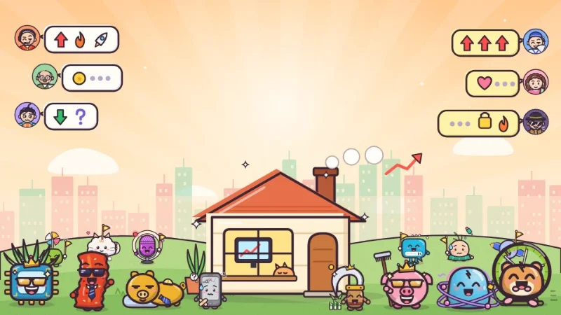
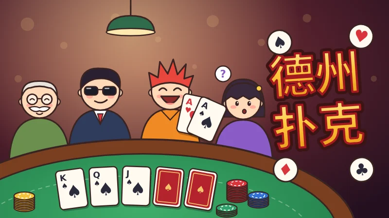
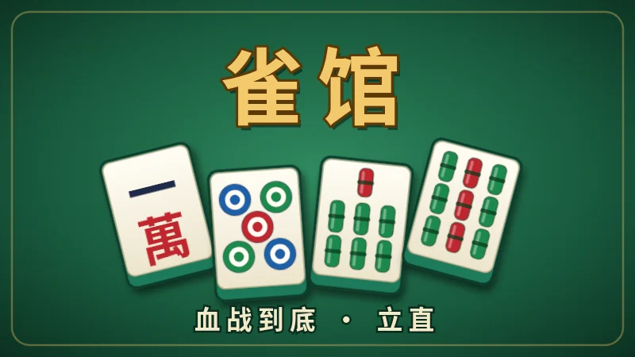
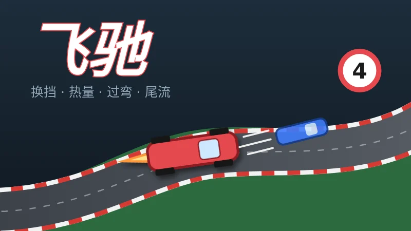
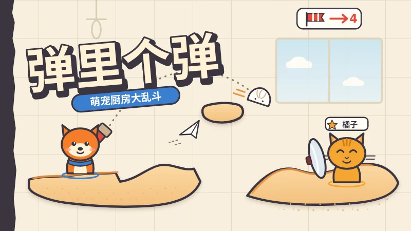
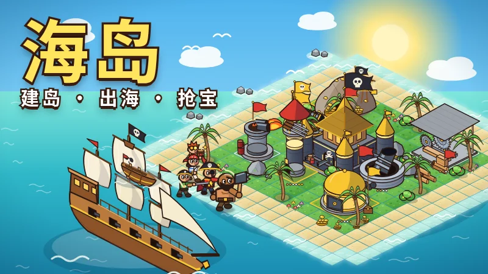
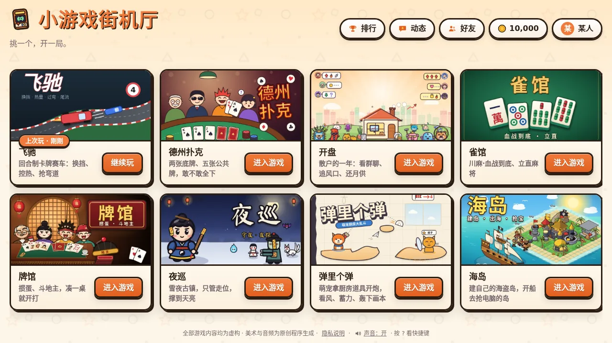
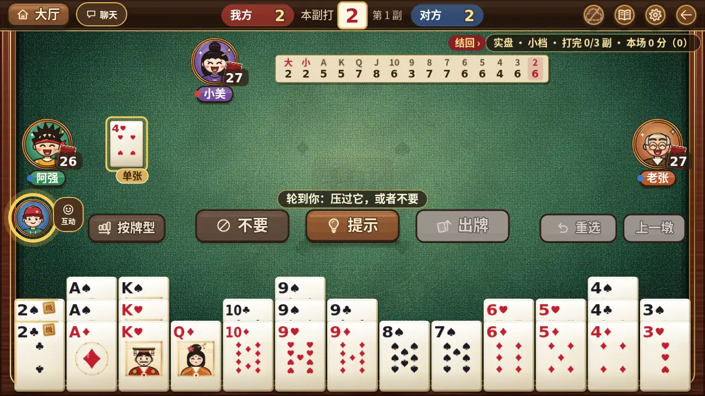
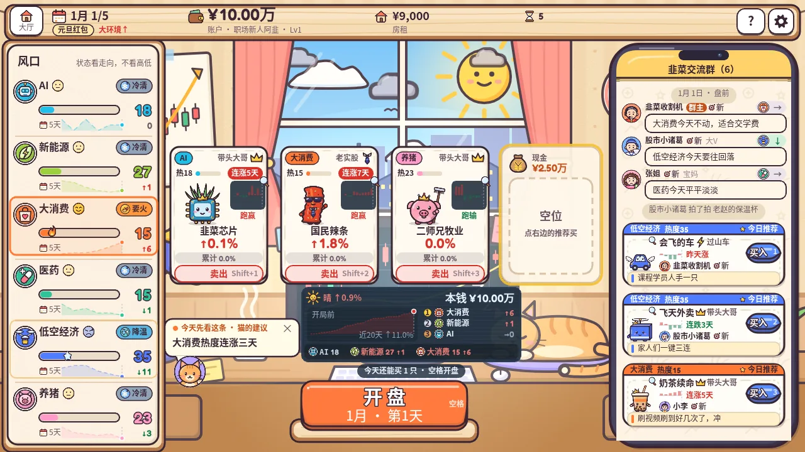
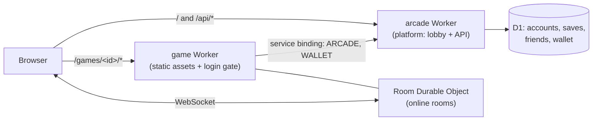

<div align="center">

# Arcade

**A mini-game arcade you host yourself — on Cloudflare Workers or on your own server — with one lobby, one account, many games.**

A lobby with accounts, cloud saves, friends, leaderboards and a play-chip wallet, plus a growing set of
browser games (a stock-market roguelike, a card hall with Guandan and Dou Dizhu, Texas Hold'em, a mahjong hall with Sichuan and Riichi rules, a survivors-like action game, turn-based card racing, a turn-based artillery game and a pirate island raiding game)
that you can play solo against the computer or in private rooms with friends. It runs on Cloudflare Workers, or on your own machine with the self-hosting kit.

[](https://github.com/gzyyyyyyu/arcade/actions/workflows/check.yml)
[](LICENSE)


**English** · [简体中文](README.zh-CN.md)

[Quick start](#quick-start) · [Deploy](#deploy) · [Self-hosting](docs/self-hosting.md) · [Architecture](#architecture) · [Documentation](#documentation) · [Contributing](CONTRIBUTING.md)

</div>

| 开盘 · Kaipan | 牌馆 · Card Hall | 德州 · Texas Hold'em | 雀馆 · Mahjong |
|:---:|:---:|:---:|:---:|
|  |  |  |  |
| Stock-market roguelike driven by real historical price data | Guandan (4 players) and Dou Dizhu (3 players) | No-limit Hold'em, 2–9 seats | Sichuan "bloody" and Riichi mahjong |
| **夜巡 · Night Patrol** | **飞驰 · Racing** | **弹里个弹 · Danli** | **海岛 · Haidao** |
|  |  |  |  |
| Survivors-like action, Vigil and Night Raid modes | Turn-based card racing, 2–6 cars | Turn-based artillery on destructible terrain | Pirate island base-building and raids |

> There is no public demo hosted from this repository: run it locally (see [Quick start](#quick-start)) or host your own copy (see [Deploy](#deploy)).
> The games' user interface is in Simplified Chinese. Chips are play money only: they cannot be bought, sold, exchanged or transferred.

| Lobby | Card Hall (Guandan) | Kaipan |
|:---:|:---:|:---:|
|  |  |  |

## Features

- **One account for every game** — username + password + recovery code, invite-only by default with an admin switch for open registration.
- **Cloud saves, friends, leaderboards and match history** shared by all games through the platform's `/api`.
- **Play-chip wallet** — one wallet across games; every game has a "fun" mode (nothing at stake) and most also a "stake" mode where you bring play chips to the table; daily relief, server-side settlement for online rooms.
- **Private online rooms** built on Durable Objects (WebSocket hibernation, a single alarm per room, the server never sends anyone's hidden cards).
- **Solo play against computer opponents** that runs entirely in the browser — no server cost per hand.
- **Mobile-first** — tested on low-memory iPhones and iPads: capped render scale, visual-viewport sizing, safe areas, WebGL context loss recovery.
- **Deterministic rules cores** — each game's rules are pure functions with seeded RNGs, enforced by architecture tests, so saves, replays and bug reports are reproducible.
- **Modules you can split** — the platform, each game and the shared packages are independent modules with their own dependencies, tests, Worker and deploy workflow.
- **Two ways to run it** — on Cloudflare Workers, or on your own machine with a bare `workerd` binary or Docker (SQLite or PostgreSQL); the module code is the same.

## Games

| Module | Game | Highlights |
|---|---|---|
| [`games/kaipan`](games/kaipan/) | **开盘 Kaipan** | Roguelike about a retail investor; 135 real price segments (public-domain data) drive the market; daily challenge and posters. |
| [`games/guandan`](games/guandan/) | **牌馆 Card Hall** | Two games on one card table: Guandan with complete competitive rules and per-hand review, and classic Dou Dizhu (bid 1–3, bombs and spring double the stake); solo vs. computer players, private rooms, quick match. Layering in its `docs/doudizhu.md`. |
| [`games/texas`](games/texas/) | **德州扑克 Texas Hold'em** | No-limit, 2–9 players, computer personalities, private rooms, stickers and props. |
| [`games/mahjong`](games/mahjong/) | **雀馆 Mahjong** | One engine for many variants; Sichuan "bloody" rules and Riichi (Tenhou-style hanchan or tonpuu, `docs/riichi.md`); ready-hand hints, private rooms, quick match. |
| [`games/yexun`](games/yexun/) | **夜巡 Night Patrol** | Survivors-like action: steer a young Taoist through a snowy old town; Vigil (survive until dawn) and Night Raid (loot and extract) modes; deterministic fixed-tick simulation, daily challenge. |
| [`games/racing`](games/racing/) | **飞驰 Racing** | Turn-based card racing (shift gears, manage heat, brake for corners, slipstream); three tracks, computer drivers, private rooms. Contributed by a community member; play-for-fun only, no wallet. |
| [`games/danli`](games/danli/) | **弹里个弹 Danli** | Turn-based artillery with pets and kitchen gear: destructible dough terrain, wind, climbing on a stamina budget, fall off the page and you are out. Play against the computer (1v1 up to 3v3, empty seats filled by bots) or with friends in a private room. Contributed by a community member; play-for-fun only, no wallet. |
| [`games/haidao`](games/haidao/) | **海岛 Haidao** | Pirate island base-building: build and defend your island, raid computer islands and other players' bases asynchronously, tower-defence chapters. |

Current versions and what is in progress: see each module's `package.json` and `CHANGELOG.md`.

## Quick start

Requirements: **Node.js 22** (see `.nvmrc`) and npm. You do not need a Cloudflare account to develop or test.
Every module is installed and run on its own — there is no root `package.json`.

```bash
git clone https://github.com/gzyyyyyyu/arcade.git
cd arcade/games/texas       # or platform, games/kaipan, games/guandan, games/mahjong, games/yexun, games/racing, games/danli, games/haidao
npm ci
npm run dev                 # local dev server (single-player works without the platform)
npm test                    # unit tests (vitest) and Worker tests
npm run build               # production build
```

| Module | Dev port | Preview port |
|---|---|---|
| platform | 5180 (API: `npm run dev:api` on 5181) | 4180 |
| games/kaipan | 5173 | 4173 |
| games/guandan | 5174 | 4174 |
| games/texas | 5175 | 4175 |
| games/mahjong | 5176 | 4176 |
| games/racing | 5177 | 4177 |
| games/yexun | 5178 | 4178 |
| games/danli | 5179 | 4179 |
| games/haidao | 5170 | 4170 |

**Lobby and games together.** In `platform/`, run `npm run dev:api` and `npm run dev` side by side and open <http://localhost:5180>.
In development the lobby links each game to that game's own dev server (the `devUrl` in `platform/shared/games.ts`), so also start the games you want to open.
To run the whole site from your checkout as it runs in production, build a release with the self-hosting scripts ([docs/self-hosting.md](docs/self-hosting.md#without-docker-binary--systemd)).

Packages (`packages/arcade-kit`, `packages/arcade-host`) have no dev server, only tests. Each module's README explains its own scripts, smoke tests and tools.
Before opening a pull request, also run `node tools/check-isolation.mjs` at the repository root (needs no install).

## Deploy

| Option | What you get | How |
|---|---|---|
| **Self-host** (Docker or a binary) | Whole site on your own server, SQLite or PostgreSQL | [docs/self-hosting.md](docs/self-hosting.md) |
| **Cloudflare, whole site** | Platform + games on Workers, D1 and Durable Objects, one hostname | [docs/deployment.md](docs/deployment.md#cloudflare-whole-site-from-a-fork) |
| **Cloudflare, one game** | A single game on `workers.dev`, guest play and friend rooms, no accounts | [docs/deployment.md](docs/deployment.md#cloudflare-one-game) |

To try self-hosting on your machine, build the image from your checkout (Node 22 and Docker), start it, then open <http://localhost:8787>:

```sh
npm ci --ignore-scripts --prefix tools/deployer
(cd packages/arcade-host && npm ci && npm run build)
v=$(git rev-parse --short HEAD)
tools/selfhost/pack-all.sh build/art && ARCADE_VERSION=$v tools/selfhost/release.sh build/art build/out --with-pg
docker build -f tools/selfhost/docker/Dockerfile -t arcade:local build/out/arcade-$v
s=tools/selfhost/docker/secrets.env   # git-ignored
for k in PEPPER_PW PEPPER_RC PEPPER_SID PEPPER_IP ADMIN_TOKEN; do echo "$k=k1:$(openssl rand -hex 24)"; done > $s
docker run -d --name arcade -p 127.0.0.1:8787:8787 -v arcade-data:/data --env-file $s arcade:local
docker exec arcade /app/ops/create-admin.sh zhanzhang 站长   # prints the first admin's password and recovery code once
```

The project's own site runs on one of these targets; maintainers choose which and do the deploys ([docs/deployment.md](docs/deployment.md)).

## Architecture



| Path | Contents |
|---|---|
| [`platform/`](platform/) | Lobby (React) and `/api` Worker: accounts, cloud saves, friends, leaderboards, wallet, admin |
| [`games/<id>/`](games/) | One game per directory, each with its own Worker, tests, `CHANGELOG.md` and deploy workflow |
| [`packages/arcade-kit/`](packages/arcade-kit/) | Shared kit, published to npm as `@yyyu-star/arcade-kit`: room base class, room entry points, browser client, protocol, metering, viewport and WebGL recovery for mobile, table interaction, chat, share cards, social widgets |
| [`packages/arcade-host/`](packages/arcade-host/) | Self-hosting runtime on workerd ([docs/self-hosting.md](docs/self-hosting.md)) |
| [`docs/`](docs/) | Cross-module design (in Chinese) |
| [`tools/`](tools/) | Repository tooling ([tools/README.md](tools/README.md)): isolation and deploy-config checks, the pinned deployer, module split, git hooks, deploy guard, self-hosting scripts |

Hard rules, enforced by `node tools/check-isolation.mjs` in CI:

- each module carries all of its own files and dependencies, and never references files outside its directory
  (except the shared packages via `file:../../packages/<name>`);
- modules talk only through public interfaces (same-origin HTTP, service bindings);
- browser storage keys are prefixed with the module id (`kaipan.`, `texas.`, …) because everything shares one origin;
- any module can be split into its own repository with `tools/split-module.sh`.

## Documentation

Detailed documentation is written in Chinese; the documents marked *(English)* are not. [docs/README.md](docs/README.md) lists every cross-module document with a suggested reading order.

- [CONTRIBUTING.md](CONTRIBUTING.md) *(English)* — how to propose a change; [docs/engineering.md](docs/engineering.md) — the quality standard every pull request is reviewed against
- [AGENTS.md](AGENTS.md) — repository conventions for humans and AI coding agents (module independence, code style, mobile rules, testing)
- [docs/self-hosting.md](docs/self-hosting.md) *(English)* — running the whole site on your own server; [docs/deployment.md](docs/deployment.md) *(English)* — the deploy pipeline and its security model
- [docs/project.md](docs/project.md) — what the project is, who it is for, principles and roadmap
- [docs/architecture.md](docs/architecture.md) — overall architecture
- [docs/platform-backend.md](docs/platform-backend.md) — platform backend design, wallet and saves (accounts, cost guard, data and monitoring are split into their own files, listed in [docs/README.md](docs/README.md)); [docs/rooms.md](docs/rooms.md) — the online-room rules every game follows; [docs/api.md](docs/api.md) — the `/api` reference
- [docs/economy.md](docs/economy.md) — the chip economy
- [docs/social.md](docs/social.md) — sharing, presence, invitations, spectating, friends' boards
- [docs/balance.md](docs/balance.md) — difficulty and payout targets shared by all games
- [docs/ui.md](docs/ui.md) — the UI rules every screen follows (buttons, dialogs, text, settings, desktop and phone, information density)
- [docs/table-fun.md](docs/table-fun.md) — the shared table-interaction spec (emotes, props, computer reactions)
- [docs/new-game.md](docs/new-game.md) — how to add a new game
- [docs/review-policy.md](docs/review-policy.md) — how pull requests are reviewed and merged (automated pre-review; only maintainers merge and deploy)
- Module READMEs: [platform](platform/README.md) · [kaipan](games/kaipan/README.md) · [guandan](games/guandan/README.md) · [texas](games/texas/README.md) · [mahjong](games/mahjong/README.md) · [yexun](games/yexun/README.md) · [racing](games/racing/README.md) · [danli](games/danli/README.md) · [haidao](games/haidao/README.md) · [arcade-kit](packages/arcade-kit/README.md) · [arcade-host](packages/arcade-host/README.md) · [tools](tools/README.md)

## Contributing

Contributions are welcome — please read [CONTRIBUTING.md](CONTRIBUTING.md), the [quality standard](docs/engineering.md) and the [Code of Conduct](CODE_OF_CONDUCT.md).
After cloning, run `git config core.hooksPath tools/git-hooks` once: it blocks direct pushes to `main` and force pushes.
Security issues: see [SECURITY.md](SECURITY.md).

## License

[MIT](LICENSE). Game assets are generated by the project's own code or come from sources whose licenses allow
commercial use; see each module's asset notes. Kaipan's market data comes from the public-domain WIKI Prices dataset.
