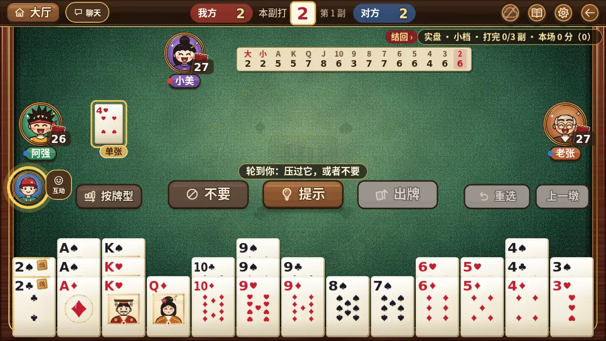
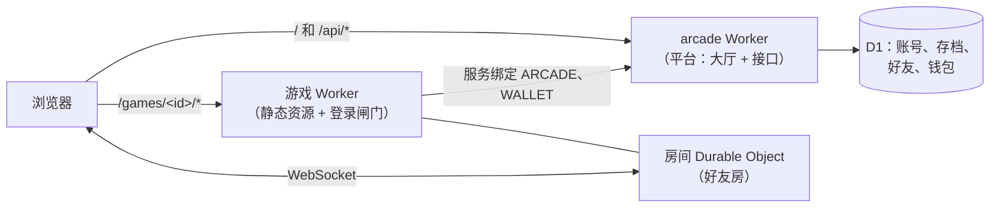

<div align="center">

# Arcade 小游戏街机厅

**可以自己托管的小游戏平台（Cloudflare Workers 或你自己的服务器）：一个大厅、一个账号，玩所有游戏。**

大厅带账号、云存档、好友、排行榜和娱乐筹码钱包；游戏有股市肉鸽《开盘》、掼蛋和斗地主《牌馆》、德州扑克、川麻和立直麻将《雀馆》、幸存者类动作游戏《夜巡》、回合制卡牌赛车《飞驰》、回合制抛物线对战《弹里个弹》、海盗海岛攻防《海岛》，
可以单机对电脑，也可以开好友房一起玩。可以部署在 Cloudflare Workers 上，也可以用自托管套件跑在自己的机器上。

[](https://github.com/gzyyyyyyu/arcade/actions/workflows/check.yml)
[](LICENSE)


[English](README.md) · **简体中文**

[快速开始](#快速开始) · [部署](#部署) · [自托管](tools/selfhost/README.md) · [架构](#架构) · [文档](#文档) · [参与贡献](CONTRIBUTING.md)

</div>

| 开盘 | 牌馆 | 德州扑克 | 雀馆 |
|:---:|:---:|:---:|:---:|
|  |  |  |  |
| 真实历史行情驱动的散户肉鸽 | 掼蛋（4 人）和斗地主（3 人） | 无限注德州，2–9 人 | 川麻·血战到底和立直麻将 |
| **夜巡** | **飞驰** | **弹里个弹** | **海岛** |
|  |  |  |  |
| 幸存者类动作，守夜 / 夜探 | 回合制卡牌赛车，2–6 辆 | 能炸地形的回合制抛物线对战 | 海盗题材的建岛和攻防 |

> 本仓库不托管公开的演示站：在本地跑起来（见[快速开始](#快速开始)），或者按[部署](#部署)一节部署你自己的一份。
> 筹码只是游戏里的分数：不能买、不能卖、不能兑换、不能转让，没有任何现金价值。

| 大厅 | 牌馆（掼蛋） | 开盘 |
|:---:|:---:|:---:|
|  |  |  |

## 特点

- **一个账号玩所有游戏**：用户名 + 密码 + 恢复码；默认邀请制，管理员可以随时开关注册。
- **云存档、好友、排行榜、战绩**：平台的 `/api` 统一提供，所有游戏共用。
- **娱乐筹码钱包**：所有游戏一个钱包，分娱乐和实盘；每天有补给；好友房由服务端结算。
- **好友房**：基于 Durable Objects（WebSocket 休眠、每个房间只用一个闹钟），服务端说了算，绝不下发别人的底牌。
- **单机对电脑**：整局在浏览器里跑，不花服务器钱。
- **手机优先**：在低内存的 iPhone、iPad 上实测过：渲染倍数封顶、按可见区域算高度、让出刘海、WebGL 上下文丢了能恢复。
- **规则可复现**：每个游戏的规则核心都是纯函数加带种子的随机数，由架构测试守着；存档、回放、复现 bug 都靠它。
- **模块随时能拆**：平台、每个游戏、共用包都是独立模块，各有依赖、测试、Worker 和部署流程。
- **两种跑法**：部署在 Cloudflare Workers 上，或者在自己的机器上用裸 `workerd` 二进制或 Docker 跑（SQLite 或 PostgreSQL），模块代码不变。

## 游戏

| 模块 | 游戏 | 亮点 |
|---|---|---|
| [`games/kaipan`](games/kaipan/) | **开盘** | 散户炒股题材的肉鸽；135 段真实历史走势（公有领域数据）驱动大盘；每日挑战、结局海报。 |
| [`games/guandan`](games/guandan/) | **牌馆** | 一张牌桌两种玩法：竞赛规则完整、每副能复盘的掼蛋，和经典叫分斗地主（叫 1–3 分，炸弹、春天翻倍）；单机对电脑、好友房、快速匹配。分层见该模块 `docs/doudizhu.md`。 |
| [`games/texas`](games/texas/) | **德州扑克** | 无限注，2–9 人；电脑性格各异；好友房；表情和道具。 |
| [`games/mahjong`](games/mahjong/) | **雀馆** | 一套引擎多种玩法；川麻·血战到底和立直麻将（天凤式半庄 / 东风，`docs/riichi.md`）；听牌提示；好友房；快速匹配。 |
| [`games/yexun`](games/yexun/) | **夜巡** | 幸存者类动作：道士夜巡雪夜古镇，只管走位；守夜（撑到天亮）和夜探（搜宝撤离）两个模式；固定步长的确定性模拟，每日挑战。 |
| [`games/racing`](games/racing/) | **飞驰** | 回合制卡牌赛车：换挡出牌、控热量、过弯限速、吃尾流；三条赛道，电脑车手性格各异，好友房。社区贡献者的作品；只有娱乐模式，不碰钱包。 |
| [`games/danli`](games/danli/) | **弹里个弹** | 回合制抛物线对战，萌宠和厨房道具大乱斗：面团地形能炸、有风、爬动花体力，掉出画本就出局；单机对电脑（1v1 到 3v3，空位电脑补），也能开好友房。社区贡献者的作品；只有娱乐模式，不碰钱包。 |
| [`games/haidao`](games/haidao/) | **海岛** | 海盗题材的建岛攻防：建设并守住自己的岛，出海打劫电脑的岛、异步进攻别的玩家，守岛（塔防）章节。 |

各模块当前版本和进展见各自的 `package.json` 和 `CHANGELOG.md`。

## 快速开始

需要 **Node.js 22**（见 `.nvmrc`）和 npm；开发和测试都不需要 Cloudflare 账号。每个模块各自安装、各自运行，仓库根没有 `package.json`。

```bash
git clone https://github.com/gzyyyyyyu/arcade.git
cd arcade/games/texas       # 或 platform、games/kaipan、games/guandan、games/mahjong、games/yexun、games/racing、games/danli、games/haidao
npm ci
npm run dev                 # 本地开发（不带平台也能单机玩）
npm test                    # 单元测试（vitest）和 Worker 测试
npm run build               # 正式构建
```

| 模块 | 开发端口 | 预览端口 |
|---|---|---|
| platform | 5180（接口 `npm run dev:api`：5181） | 4180 |
| games/kaipan | 5173 | 4173 |
| games/guandan | 5174 | 4174 |
| games/texas | 5175 | 4175 |
| games/mahjong | 5176 | 4176 |
| games/racing | 5177 | 4177 |
| games/yexun | 5178 | 4178 |
| games/danli | 5179 | 4179 |
| games/haidao | 5170 | 4170 |

**大厅和游戏一起看**：在 `platform/` 里同时开 `npm run dev:api` 和 `npm run dev`，打开 <http://localhost:5180>。
开发时大厅把每个游戏链到这个游戏自己的开发服务器（`platform/shared/games.ts` 里的 `devUrl`），所以要看哪个游戏就把哪个游戏也起起来。
想用本地代码按线上的样子跑整站，用自托管脚本打一个发布包（[tools/selfhost/README.md](tools/selfhost/README.md#不用-docker二进制--systemd)）。

共用包（`packages/arcade-kit`、`packages/arcade-host`）没有开发服务器，只有测试。各模块的脚本、冒烟测试和工具见模块自己的 README。提 PR 前还要在仓库根跑一次 `node tools/check-isolation.mjs`（不用安装依赖）。

## 部署

| 方式 | 得到什么 | 怎么做 |
|---|---|---|
| **自托管**（Docker 或二进制） | 整站跑在自己的服务器上，SQLite 或 PostgreSQL | [tools/selfhost/README.md](tools/selfhost/README.md) |
| **Cloudflare 整站** | 平台加游戏跑在 Workers、D1、Durable Objects 上，同一个主机名 | [docs/deployment.md](docs/deployment.md#cloudflare-whole-site-from-a-fork)（英文） |
| **Cloudflare 单个游戏** | 一个游戏挂在 `workers.dev`，游客身份、好友房，没有账号 | [docs/new-game.md](docs/new-game.md) 第 7 节 |

在自己机器上试自托管：在克隆下来的仓库里从源码打镜像（要 Node 22 和 Docker）、起容器，跑完打开 <http://localhost:8787>：

```sh
npm ci --ignore-scripts --prefix tools/deployer
(cd packages/arcade-host && npm ci && npm run build)
v=$(git rev-parse --short HEAD)
tools/selfhost/pack-all.sh build/art && ARCADE_VERSION=$v tools/selfhost/release.sh build/art build/out --with-pg
docker build -f tools/selfhost/docker/Dockerfile -t arcade:local build/out/arcade-$v
s=tools/selfhost/docker/secrets.env   # 不进 Git
for k in PEPPER_PW PEPPER_RC PEPPER_SID PEPPER_IP ADMIN_TOKEN; do echo "$k=k1:$(openssl rand -hex 24)"; done > $s
docker run -d --name arcade -p 127.0.0.1:8787:8787 -v arcade-data:/data --env-file $s arcade:local
docker exec arcade /app/ops/create-admin.sh zhanzhang 站长   # 只打印一次第一个管理员的密码和恢复码
```

项目自己的站点跑在其中一个目标上，跑哪个、什么时候部署由维护者定（[docs/deployment.md](docs/deployment.md)）。

## 架构



| 目录 | 内容 |
|---|---|
| [`platform/`](platform/) | 大厅（React）和 `/api` Worker：账号、云存档、好友、排行榜、钱包、管理页 |
| [`games/<id>/`](games/) | 一个目录一个游戏，各自有 Worker、测试、`CHANGELOG.md` 和部署流程 |
| [`packages/arcade-kit/`](packages/arcade-kit/) | 共用包，发布在 npm（`@yyyu-star/arcade-kit`）：房间基类、开房进房入口、浏览器连接器、协议、计量、手机视口和 WebGL 恢复、牌桌互动、聊天、分享卡、社交部件 |
| [`packages/arcade-host/`](packages/arcade-host/) | 自托管运行时（见上面的自托管） |
| [`docs/`](docs/) | 跨模块的设计文档 |
| [`tools/`](tools/) | 仓库工具（[tools/README.md](tools/README.md)）：独立性和部署配置检查、钉死的部署工具、拆分模块、git hooks、部署前核对、自托管脚本 |

几条硬约束，CI 里由 `node tools/check-isolation.mjs` 检查：

- 每个模块自带全部文件和依赖，不引用自己目录以外的文件（唯一例外：用 `file:../../packages/<name>` 依赖共用包）；
- 模块之间只走公开接口（同域 HTTP、服务绑定）；
- 浏览器存储的 key 一律加模块前缀（`kaipan.`、`texas.` ……），因为大家同域；
- 任何模块都能用 `tools/split-module.sh` 拆成独立仓库。

## 文档

跨模块文档的入口和阅读顺序见 [docs/README.md](docs/README.md)。

- [CONTRIBUTING.md](CONTRIBUTING.md)（英文）：怎么提改动；[docs/engineering.md](docs/engineering.md)：每个 PR 都按它审的工程质量标准
- [docs/deployment.md](docs/deployment.md)（英文）：部署链路和它的安全设计
- [AGENTS.md](AGENTS.md)：仓库规范，给开发者和 AI 编程代理（模块独立、代码规范、手机适配、测试）
- [docs/project.md](docs/project.md)：项目做什么、给谁、守什么底线、路线图
- [docs/architecture.md](docs/architecture.md)：整体架构
- [docs/platform-backend.md](docs/platform-backend.md)：平台后端的总体设计、钱包和云存档（账号、额度防护、数据表、监控各自一篇，见 [docs/README.md](docs/README.md)）；[docs/rooms.md](docs/rooms.md)：所有游戏都要守的联机房间规范；[docs/api.md](docs/api.md)：`/api` 接口约定
- [docs/economy.md](docs/economy.md)：筹码体系
- [docs/social.md](docs/social.md)：社交（分享、在线、邀请、旁观、好友榜）
- [docs/balance.md](docs/balance.md)：难度和收益的配平目标（所有游戏共用）
- [docs/ui.md](docs/ui.md)：界面规范（按钮、弹窗、文案、设置、电脑和手机、信息密度）
- [docs/table-fun.md](docs/table-fun.md)：牌桌互动规范（表情、道具、电脑反应）
- [docs/new-game.md](docs/new-game.md)：新游戏开发指南
- [docs/review-policy.md](docs/review-policy.md)：PR 怎么审、怎么合（自动预审，只由维护者合并和部署）
- 各模块 README：[平台](platform/README.md) · [开盘](games/kaipan/README.md) · [牌馆](games/guandan/README.md) · [德州](games/texas/README.md) · [雀馆](games/mahjong/README.md) · [夜巡](games/yexun/README.md) · [飞驰](games/racing/README.md) · [弹里个弹](games/danli/README.md) · [海岛](games/haidao/README.md) · [arcade-kit](packages/arcade-kit/README.md) · [arcade-host](packages/arcade-host/README.md) · [自托管](tools/selfhost/README.md) · [工具](tools/README.md)

## 参与贡献

欢迎贡献，请先读 [CONTRIBUTING.md](CONTRIBUTING.md)、[工程质量标准](docs/engineering.md)和[行为准则](CODE_OF_CONDUCT.md)。安全问题见 [SECURITY.md](SECURITY.md)。
克隆后先执行一次 `git config core.hooksPath tools/git-hooks`：本地拦住直接推 `main` 和 force push。

## 许可证

[MIT](LICENSE)。游戏素材由项目自己的代码生成，或来自许可明确可商用的来源，见各模块的素材说明；开盘的行情数据来自公有领域的 WIKI Prices 数据集。
