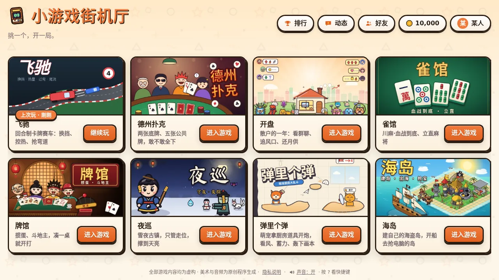
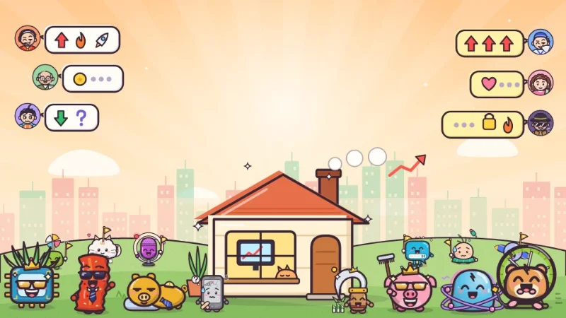
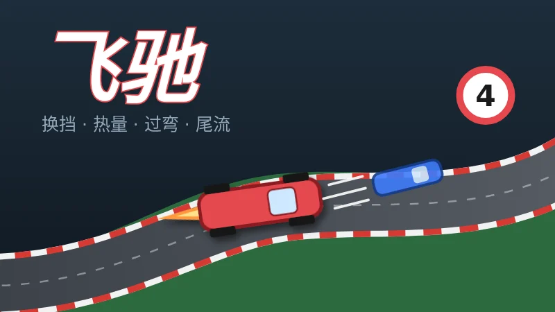
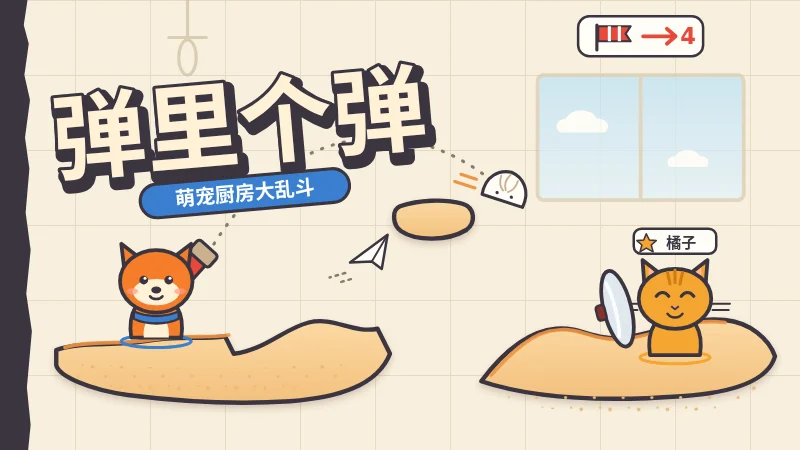
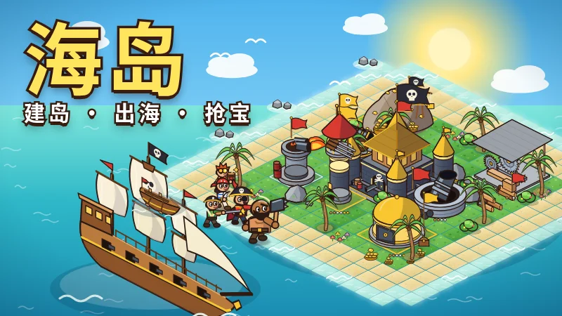

<div align="center">

# Arcade 小游戏街机厅

**可以自己托管的小游戏平台：一个大厅、一个账号、八个网页游戏，跑在 Cloudflare Workers 或你自己的服务器上。**

[English](README.md) · **简体中文**

[](https://github.com/gzyyyyyyu/arcade/actions/workflows/check.yml)
[](LICENSE)

</div>



> 本仓库不托管公开的演示站：在本地跑起来（[快速开始](#快速开始)），或者部署你自己的一份（[部署](#部署)）。
> 游戏界面是简体中文。筹码只是游戏里的分数：不能买、不能卖、不能兑换、不能转让。

## 游戏

| [开盘](games/kaipan/) | [牌馆](games/guandan/) | [德州扑克](games/texas/) | [雀馆](games/mahjong/) |
|:---:|:---:|:---:|:---:|
|  |  |  |  |
| 真实历史行情驱动的散户肉鸽；每日挑战、闪电盘、周盘 | 掼蛋（4 人）和斗地主（3 人） | 无限注，2–9 人；锦标赛 | 川麻·血战到底和立直麻将 |
| [**夜巡**](games/yexun/) | [**飞驰**](games/racing/) | [**弹里个弹**](games/danli/) | [**海岛**](games/haidao/) |
|  |  |  |  |
| 幸存者类动作：守夜、夜探两个模式 | 回合制卡牌赛车，2–6 辆 | 地形能炸的回合制抛物线对战 | 海盗题材的建岛、打劫和守岛塔防 |

每个游戏都能单机对电脑；牌桌类游戏和两个社区游戏（飞驰、弹里个弹）还能开好友房。除飞驰、弹里个弹外都有带钱包筹码的实盘。细节见各游戏的 README。

## 特点

- **一个账号玩所有游戏**：用户名、密码加恢复码；默认邀请制，管理员可以开关公开注册。
- **平台统一提供的服务**：云存档、好友、排行榜、战绩和娱乐筹码钱包，都走平台的同域 `/api`。
- **单机在浏览器里跑**：电脑对手全在浏览器里算，单机一局不花服务器钱。
- **好友房**基于 Durable Objects：WebSocket 休眠、每个房间一个闹钟，服务端绝不下发别人的底牌。
- **规则可复现**：规则核心是纯函数加带种子的随机数，由架构测试守着；存档、回放、复现 bug 都靠它。
- **手机优先**：在低内存的 iPhone、iPad 上实测过（渲染倍数封顶、按可见区域算高度、让出刘海、WebGL 上下文丢了能恢复）。
- **模块随时能拆**：平台、每个游戏、每个共用包都有自己的依赖、测试、Worker 和流程。
- **两种跑法**：Cloudflare Workers，或者在自己的机器上用一个 `workerd` 进程（二进制或 Docker，SQLite 或 PostgreSQL），模块代码不变。

## 快速开始

需要 Node.js 22（见 `.nvmrc`）和 npm。开发和测试不需要 Cloudflare 账号。根目录没有 `package.json`：每个模块各自安装、各自运行。

```bash
git clone https://github.com/gzyyyyyyu/arcade.git
cd arcade/games/texas     # 或 platform、packages/arcade-kit、任一 games/<id>
npm ci
npm run dev               # 开发服务器；不接平台也能单机玩
npm test                  # 单元测试（vitest）
npm run build             # 正式构建
```

要连大厅一起跑：在 `platform/` 里同时起 `npm run dev:api` 和 `npm run dev`，打开 <http://localhost:5180>；大厅把每个游戏链到它自己的开发服务器，所以想进的游戏也要起。
开发端口见 [AGENTS.md](AGENTS.md#3-本地开发) 第 3 节和各模块的 README。提 PR 前还要在仓库根跑 `node tools/check-isolation.mjs`。

## 部署

| 方式 | 得到什么 | 步骤 |
|---|---|---|
| 自托管（Docker 或二进制） | 整站跑在自己的服务器上，SQLite 或 PostgreSQL | [docs/self-hosting.md](docs/self-hosting.md)（英文）、[tools/selfhost/README.md](tools/selfhost/README.md)（中文） |
| Cloudflare 整站 | 平台和游戏跑在 Workers、D1、Durable Objects 上，同一个主机名 | [docs/deployment.md](docs/deployment.md#cloudflare-whole-site-from-a-fork)（英文） |
| Cloudflare 单个游戏 | 一个游戏放在 `workers.dev`，游客身份玩、能开好友房，没有账号 | [docs/new-game.md](docs/new-game.md#7-单独部署这个游戏不要平台) 第 7 节 |

## 目录结构

```
platform/              大厅（React）和 /api Worker：账号、存档、好友、排行榜、钱包、管理
games/<id>/            一个目录一个游戏，各有自己的 Worker、测试和 CHANGELOG
packages/arcade-kit/   共用包，发布在 npm（@yyyu-star/arcade-kit）：房间、浏览器连接、计量、手机视口、牌桌互动、社交部件
packages/arcade-host/  自托管运行时（workerd）
tools/                 独立性和部署配置检查、钉死版本的部署程序、拆模块、git 钩子、自托管脚本
docs/                  跨模块的设计文档（中文）和部署指南（英文）
```

浏览器在 `/`、`/api/*` 访问平台，在 `/games/<id>/` 访问各游戏自己的 Worker；游戏经服务绑定调平台。
每个模块自带全部文件、不引用目录外的文件（共用包除外），可以用 `tools/split-module.sh` 拆成独立仓库。完整规则见 [AGENTS.md](AGENTS.md)，CI 里由 `tools/check-isolation.mjs` 检查。

## 文档

设计文档是中文，标了（英文）的除外。[docs/README.md](docs/README.md) 列出全部文档和阅读顺序。

- [CONTRIBUTING.zh-CN.md](CONTRIBUTING.zh-CN.md)（[English](CONTRIBUTING.md)）—— 改动怎么进来；[AGENTS.md](AGENTS.md) —— 给人和 AI 代理的仓库规则（模块独立、规则和画面分开、确定性、测试、Git）
- [docs/project.md](docs/project.md) —— 项目是什么、给谁玩、底线和路线图
- [docs/architecture.md](docs/architecture.md) —— 模块、路由和部署形态
- [docs/engineering.md](docs/engineering.md) —— 代码、测试、文档和 PR 的质量标准；[docs/ui.md](docs/ui.md) —— 每个界面都守的规范
- [docs/new-game.md](docs/new-game.md) —— 怎么加一个游戏；[docs/rooms.md](docs/rooms.md) —— 联机房间规范
- [docs/economy.md](docs/economy.md) —— 筹码体系；[docs/balance.md](docs/balance.md) —— 难度和收益的配平目标
- [docs/table-fun.md](docs/table-fun.md) —— 牌桌上的表情和道具；[docs/social.md](docs/social.md) —— 分享、在线、邀请、旁观
- [docs/platform-backend.md](docs/platform-backend.md) —— 平台后端设计和费用防护；[docs/api.md](docs/api.md) —— `/api` 接口约定
- [docs/self-hosting.md](docs/self-hosting.md)（英文）—— 在自己的服务器上跑；[docs/deployment.md](docs/deployment.md)（英文）—— 部署链路和安全设计
- [docs/review-policy.md](docs/review-policy.md) —— PR 怎么审、怎么合并
- 各模块的 README：[platform](platform/README.md) · [kaipan](games/kaipan/README.md) · [guandan](games/guandan/README.md) · [texas](games/texas/README.md) · [mahjong](games/mahjong/README.md) · [yexun](games/yexun/README.md) · [racing](games/racing/README.md) · [danli](games/danli/README.md) · [haidao](games/haidao/README.md) · [arcade-kit](packages/arcade-kit/README.md) · [arcade-host](packages/arcade-host/README.md) · [tools](tools/README.md)

## 参与贡献

欢迎贡献：先读 [CONTRIBUTING.zh-CN.md](CONTRIBUTING.zh-CN.md) 和[行为准则](CODE_OF_CONDUCT.md)。克隆后执行一次 `git config core.hooksPath tools/git-hooks`。
安全问题见 [SECURITY.md](SECURITY.md)。

## 许可证

[MIT](LICENSE)。游戏素材由项目自己的代码生成，或来自许可允许商用的来源，见各模块的素材说明。开盘的行情数据来自公有领域的 WIKI Prices 数据集。
