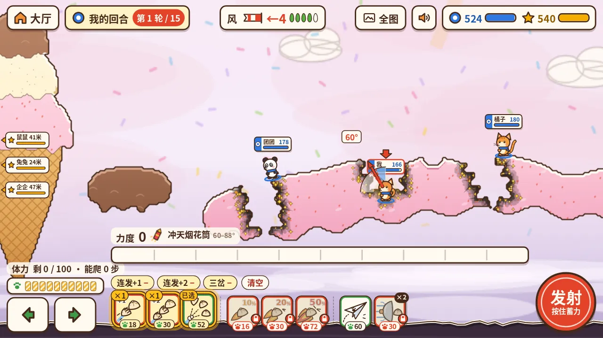

# 弹里个弹（games/danli）

回合制抛物线对战：两队小动物站在悬空的面团地形上，轮流调角度、按住蓄力、看风开炮，把对手打空血量或轰出画本就赢。



设计见 [DESIGN.md](DESIGN.md)，数值和配平见 [docs/balance.md](docs/balance.md)，模块约定见 [AGENTS.md](AGENTS.md)，更新见 [CHANGELOG.md](CHANGELOG.md)，素材来源见 [ASSETS.md](ASSETS.md)。

## 玩法一览

- 单机：先进准备房间挑对阵（1v1、2v2、3v3，空位由电脑补，电脑可以是队友也可以是对手）、地图（11 张，或"随机"）和武器（8 把）；
  6 位电脑人物（名字和偏好的武器见 `src/ai/personas.ts`）各拿自己喜欢的武器。打到一半关掉，下次首页"接着上一局"。
- 道具：常用道具（连发、三岔、加力）一回合能任意组合，只看体力；特殊道具纸飞机（人飞到落点）、锅盖（这一发不受风）。
- 我方真人出局以后能快进或跳到结果；结算页有每个人的伤害、命中、轰出画本。
- 好友房：开个房间把链接发给朋友，一起在线打，空位让电脑补（下一节）。
- 音效全部 WebAudio 现场合成；画面全部程序画的（见 ASSETS.md）。没有特技、怒气和新手教程。

## 好友房

- 首页"好友房"：**开房间**，或者**输房间码**（6 位数字）；朋友发来的链接（`…/games/danli/?room=<码>`）打开就进房。
- 房间页：顶上房间码、"复制链接"（接入 Arcade 平台时登录了还有"叫好友"，kit 的邀请面板）；进房的人自动坐进空位，点别的空位能换；
  每人在自己的位子上选小动物、武器，点"准备"；房主改对阵、地图，加电脑、替电脑换人物和武器、撤电脑，请一直不准备的人下场；
  真人都准备了、两队都有人，房主点"开打！"。没坐下的人（一个房间最多 6 个人坐下）在旁边看，对局中进来的先看，打完再坐。
- 对局：轮到你时爬、道具、角度、力度只在本机预演，按"发射"把这一回合打成一条消息发给房间，房间验过、结算完广播结果，所有人按它放动画。
  30 秒没出手算弃权；掉线 60 秒后电脑托管，回来交还。顶栏有倒计时，轮到别人写"某某正在瞄准…"，名牌上挂"掉线""电脑代打"。
- 结算：房主"再来一局"大家回到同一个房间（选择都留着，要重新准备）；"回房间"先回房间页；"大厅"离开房间。
- 房主：开房的人。准备、结算时房主掉线满 60 秒，房主交给下一个坐着的真人（按座位顺序），回来不收回；点"大厅"离开也马上交出去；对局中不交。
- 刷新、断网、切后台：自动重连，回来拿全量快照、整局重放；刷新后自动回房。
- 怎么实现的（kit 的 `GameRoom`、一回合一条消息、视图不带种子、动画停顿、写入和 CPU 预算）见 DESIGN.md 5.6。

本地联机（不要 Cloudflare 账号）：

```bash
npm run dev:worker   # 打包页面，本机起 Worker（wrangler dev，端口 4179），房间、计量都是本地的 Durable Object
                     # 打开 http://localhost:4179/games/danli/?name=小A 开房，另一个浏览器（或无痕窗口）打开复制的链接，加 &name=小B
```

没有平台时是 kit 的独立模式：每个浏览器一个游客身份，昵称取地址上的 `?name=`；`npm run dev`（vite）只有单机，开不了房。

## 开发

```bash
npm ci
npm run dev        # http://localhost:5179/games/danli/（平台的 /api 转给 5181，没起也能玩，当游客）
npm run lint       # Biome（仓库统一的规则模板 biome.jsonc）
npm test           # tsc（页面和 Worker）+ vitest + 好友房的服务器 CPU 预算（npm run cpu）
npm run build:cf   # 打包到 dist-cf/games/danli/（部署用）
npm run smoke      # 无头浏览器：手机横屏、竖屏各走一遍"首页 → 房间 → 开打 → 自己出局 → 跳到结果 → 结算"，
                   # 再走一遍好友房（本机起真的 Worker，两个浏览器上下文）；控制台零报错。npm run smoke net 只走好友房
npm run shots      # 验收截图：电脑 1280×720、手机竖屏 390×844，存到 shots/<屏>-<场景>.png；npm run shots friend 只截好友房
npm run cpu        # 好友房服务器每一步的 CPU（npm test 的最后一步；开发机门槛 p99 ≤ 3 ms，有环境变量 CI 时 8 ms）
npm run dev:worker # 本机起 Worker 试好友房（见"好友房"一节）
npm run perf       # 手机性能：CPU 降速 4 倍，量跟随、拖动、跟炮弹的帧
npm run sim 100    # 模拟器：电脑对电脑打 100 局，用法见下面"数值"
```

无头浏览器用 playwright-core，浏览器找法见 `scripts/browser.ts`（环境变量 `CHROME`，或 playwright 缓存里的 chrome-headless-shell）。
地址上带 `?seed=数字` 时新开的局用这个种子（复现、截图用）；带 `?turbo` 时动画加速（冒烟用）。页面上有一个只读的 `window.__danli`（看状态、问电脑会怎么打），给冒烟和截图脚本用。

## 结构

```
src/core/      规则核心（纯函数、确定性）：fixed 整数角度表和整数开方、terrain 地形网格、maps 地图的结构和光栅化、mapData / mapData2 11 张图的数据、
               craters 8 把武器的坑形、physics 炮弹、weapons 武器表、items 道具表、rules 开局（摆人）、回合和结算
src/ai/        电脑：personas 电脑人物和偏好的武器（名字要登记进平台的保留昵称）、index 出手（单机档）、online 好友房的联机档
src/view/      画面：scene 战场（镜头、动画、角度盘、画面外小牌、角色贴着地面倾斜）、terrainArt 地形分块烘焙（带每块的焦痕层）、terrainPaint 多材质地形画法、
               scorch 焦痕要用的坑序列、scorchPaint 8 把武器的焦痕画法、mapArt / mapArt2 材质、纹理、远景和地图卡片、
               paintKit 纹理和远景共用的小画法、backdrop 烘焙远景和纸边、backdrops 十一种远景主题、chars 队标名牌小牌和小画布、charArt 小动物的全身和头像、hud 对局界面（道具栏、静音、快进和跳到结果）、
               itemIcons 道具图标、weaponArt 武器图标、炮弹和界面小图标、stage 页面的舞台（按设计尺寸等比缩放）、lobby 首页、room 准备房间、friendRoom 好友房的房间页、result 结算页、
               title 标题字、thumb 地图缩略图、pages.css 页面样式、sound 音效（WebAudio 现场合成）
src/net/       好友房的规则（纯函数，房间和页面共用）：rules 房间的 RoomGame（准备、对局、结算）、replay 一回合一条 Rec 和页面重放、anim 每一手放多久
src/friend.ts  好友房的页面这一层：开房、进房、RoomClient、按阶段换页、danli.room；friendGame.ts 好友房的对局（本机预演、按房间结果放动画）
src/room.ts    准备房间的设置（对阵、地图、我的样子和武器、电脑座位）和 danli.prefs 的存取；点"开打"时换成开局设置
src/solo.ts    单机存档（danli.solo：种子 + 整局的开局设置 + 操作序列，读档时重放；版本对不上的直接丢掉）
src/stats.ts   结算页的统计（伤害、命中、轰出画本、结果）：按存档重放算
src/main.ts    页面入口：首页 → 准备房间 → 对局 → 结算（再来一局、回房间、大厅）
worker/        Worker（入口 main.ts，路由 route.ts，好友房 room.ts）：/games/danli/health 给平台巡检；独立部署时站点根转到 /games/danli/，首页过 kit 的登录闸门（接入平台时要登录、单独部署时是游客）；
               开房、进房交给 kit 的 acceptCreate、acceptJoin
test/          vitest：Worker 的 health、确定性、角度表、地形和挖坑、物理、爬和体力、掉落出局、伤害、道具、回合和胜负、3v3 轮转、11 张图的数据、出生点、
               8 把武器、电脑、房间设置和存档、结算统计、架构约束；好友房的规则（net.test）、真的 kit 房间（room-do.test，fake-workers 顶替运行时）；
               cpu-bench.ts 服务器 CPU 的量法（scripts/cpu.ts 跑）
scripts/       冒烟、截图、性能、模拟器、CPU 预算；worker.ts 本机起 Worker，net.ts 好友房的那一遍（冒烟、截图共用）
docs/          balance.md 数值、模拟器结果和调参过程
public/        README 用的截图
```

## 数值

规则里的数都在代码里一处（世界和物理、武器、道具、体力、血量、掉落），现在的值、模拟器结果和调参过程都在 [docs/balance.md](docs/balance.md)。结论：

- 常用道具单项"用对不用"胜率 47%–57%，最常用的叠法（连发 +1 + 加力 50%）占三成；
- 1v1 平均约 10 轮、掉出画本约三成；3v3 约 12.5 轮、掉出画本约六成；
- 11 张图除了寿司长台（慢图）都在目标区间里，8 把武器平均胜率 40%–60%；
- 好友房的联机档电脑比单机档弱，服务器每一步 p99 在 3 ms 预算以内。

模拟器（`scripts/sim.ts`）：`npm run sim [局数] [选项……]`，电脑对电脑打 N 局（种子 0..N−1，结果逐格可复现）。
选项：`1v1` / `2v2` / `3v3` 换对阵，`mix` 电脑拿性格武器，`room` 用准备房间的默认阵容，`map:<id>` 换地图、`map:all` 11 张各打一遍，
`cap:N` 改打满几轮，`ab` 比各道具用和不用，`weapons` 8 把武器两两对打，`online` 联机档电脑对单机档。改了数值或电脑要跑的那一组见 docs/balance.md 第 2 节。

## 性能

- 远景整张、地形每 256×256 一块，都是烘焙好的画布，放在"镜头那一层"里按世界坐标摆好；镜头平移缩放只改这一层的 CSS transform（交给合成器），每帧不重贴；
  炸到哪块只重画哪块。上面一张透明画布每帧只画纸边、角色、炮弹、特效和名牌，JS 一帧约 1–2 ms。
- 焦痕（DESIGN.md 2.3.1）：每块地形另有一张只增不减的焦痕层（炸到过才建），新坑挖完只往相交的层上画这一个坑一次；重烘焙那一块时裁到有地的轮廓里贴上去，
  不会每次重烘焙都把所有坑重画一遍。读档、重连、跳到最新的局面时从地图原样按坑的先后重来一遍（先挖再画），和一手一手放出来的一样。
- 弹道的镜头（DESIGN.md 2.2.1，只是画面）：轨迹出手时已经算好，镜头把所有炮弹的整条弹道（上下再多留一点给人和爆炸）框进看得见的那一块，缩放 0.5–1；
  框不下时跟着第一颗还在飞的炮弹：炮弹在画面中间的"活动框"里（横着往飞的方向留空间，竖着中线上下 0.32）镜头不动，出了框才推着镜头走。炮弹位置在 path 的两步之间插值。
- 角色贴着地面倾斜（DESIGN.md 2.4，只是画面）：脚底左右各 12 单位处的地表算坡度，最多 ±35°，每帧缓过去；名牌、箭头、角度盘不歪，瞄准仍按水平线算。
- 画布渲染倍数封顶 2（手机按像素比 3 时也按 2 画）；远景按 0.4 倍烘焙。
- 实测（`npm run perf`，无头 Chrome、关 GPU 的软件渲染，手机横屏 844×390）：不降速时跟随、拖动、跟炮弹都是一帧 16.7 ms；
  CPU 降速 4 倍、像素比 3（画布按 2 画）时一帧约 50 ms（p95 约 67 ms），像素比 1.5 时约 33 ms，像素比 1 时中位 16.7 ms；
  每帧 JS 只花 1–2 ms，其余是软件合成整屏透明画布的时间（把上面那张画布或下面那一层任意藏掉一张，降速 4 倍也是 16.7 ms）。真机由 GPU 合成，还要在手机上实测确认。
- 局末坑多（`npm run perf` 的后半段：3v3 打到第 12 轮的存档，86 个坑、6 把武器，同样降速 4 倍、像素比 3）：
  读档时重建焦痕 471 ms（建了 28 张焦痕层）、首次烘焙 24 块共 490 ms；之后跟随、跟炮弹的帧和开局一样（中位 50 ms、p95 67 ms，画一帧中位约 2 ms）；
  新坑画一次焦痕约 6 ms、跟着重烘焙 4 块平均约 5 ms 一块。焦痕层和地形块一样大（渲染倍数 2 时一张约 1 MB），28 张约 30 MB。

## 监控

照仓库根 docs/platform-backend.md 第 16 节接平台的监控：
- `GET /games/danli/health` 回 `{"ok":true,"version":"<package.json 的 version>"}`（不缓存）：排在 Worker 路由最前面，不过登录闸门、不读存储、不问平台，单独部署也能访问；版本号从 `package.json` 导入，打包时内联；
- `wrangler.jsonc` 开着 `observability`（Workers Logs）；
- 页面入口调一次 kit 的 `reportErrors`（`arcade-kit/report`），没人接住的报错报给平台的 `/api/client-error`：只带报错、调用栈、路径、游戏和版本。

## 部署

`wrangler.jsonc` 是独立配置（静态资源 `ASSETS`，好友房的 Durable Object `ROOM`（`DanliRoom`）、`METER`（kit 的 `RoomMeter`），迁移 `v1` 用 `new_sqlite_classes`；
不写平台绑定和 `GATE`）：`npm run deploy` 能单独部署成一个游客就能玩（好友房也能开）的游戏。
好友房的开房门槛写在 `vars.KIT_QUOTA`（kit 的 `RoomMeter` 读）：每人同时 5 个、每天 30 个房间；本游戏当天写入到 3,000 行不开新房、到 4,000 行在打的房间体面收场（按仓库根 docs/platform-backend.md 4.7 的写入总账分的）。
接入 Arcade 平台时由部署工具补平台绑定、`GATE`、路由（见仓库根 docs/new-game.md 第 4、5 节）。还没有接平台的云存档和排行榜。

## 参与贡献

改动走 PR，流程和审阅清单见仓库根的 [CONTRIBUTING.md](https://github.com/gzyyyyyyu/arcade/blob/main/CONTRIBUTING.md)。提交前在本目录跑：

```bash
npm run lint && npm test && npm run build:cf && npm run smoke
```

再在仓库根跑 `node tools/check-isolation.mjs`。改了数值或电脑，按 docs/balance.md 第 2 节跑模拟器；改了界面，跑 `npm run shots` 自己看一遍截图。

## 许可证

MIT，见 [LICENSE](LICENSE)。
