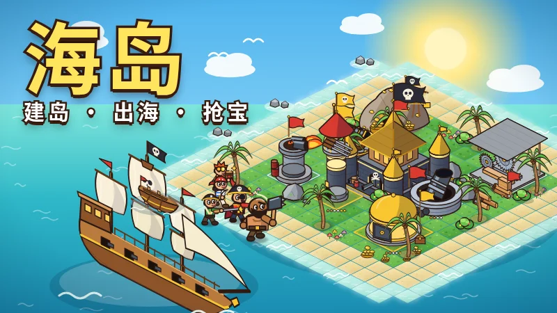

# 海岛 · Haidao

A pirate island game: build your base, storm AI pirate islands, and hold your own island against waves of raiders.

**English** · [简体中文](README.zh-CN.md)



## Features

- **Instant base building**: buildings, walls and recommended layouts; every build and upgrade finishes immediately, pacing comes from resources and campaign stars.
- **Beach landings**: pick a beach, land your boats, the crew fights on its own; back them up with flagship barrages, signal flares and supply drops. 30 campaign islands, 6 boss islands, three stars each.
- **Island defense (tower defense)**: 6 chapters, 36 levels; previews of the next two waves, one counter table for who beats whom, chapter mechanics, in-level events, two heroes. Plus "Pirate Raid" on your own island and a weekly endless "Spring Tide" with a leaderboard.
- **Escort and treasure route**: escort a merchant ship to port (set speed, repair, build towers); a daily four-stop treasure route shared by all players, with a daily leaderboard.
- **Async PvP**: raid other players' island snapshots; the server replays every battle to settle it, with shields, defense replays and revenge.
- **Chip modes**: four modes can be played with Arcade chips; results depend only on tier, seed and in-match actions, never on your progression. Chips have no cash value and can only be exchanged one way into in-game gold or timber.
- **Training camp**: short lessons, one per troop type, plus formation and tower-placement drills.
- **All art and sound generated in code**: SVG sprites baked at startup and WebAudio synthesis; no image or audio files (see [ASSETS.md](ASSETS.md)).

## Quick start

Requires Node ≥ 22.18 (see `.nvmrc`; scripts in `tools/` run directly on `node` via type stripping).

```bash
npm ci
npm run dev        # http://localhost:5170/ (preview: npm run preview → 4170)
npm test           # type check (page + Worker) + vitest
npm run build      # production build; npm run build:cf builds into dist-cf/games/haidao/
```

Without the Arcade platform the game runs as a guest, with saves in browser storage. Other commands: `npm run lint` (Biome, must be clean), `npm run sim -- --n 50` (bots play every level), `npm run art -- <dir>` (render sprites to PNG), `npm run shot -- --out <dir>` (headless smoke test; first run `npx playwright-core install chromium`). The full command list is in [docs/tools-haidao.md](docs/tools-haidao.md).

## Project layout

```
src/
  core/       rules core: pure functions, fixed 20 ticks/s, seeded RNG, no DOM or Phaser
  content/    data tables: buildings, troops, levels, maps, chip tables
  view/       Phaser scenes and DOM UI; art/ holds the code-drawn SVG sprites
  platform/   local and cloud saves
  net/        API calls for PvP, chip modes and leaderboards
worker/       Cloudflare Worker: login gate, PvP API, chip wallet API; pvp/ holds the Durable Object logic
tests/        vitest, including golden fingerprints for tower defense and escort
tools/        simulators, balance and economy tools, art preview, headless smoke tests
public/       cover, icon, leaderboard display config
```

## Documentation

Design docs are in Chinese.

- [DESIGN.md](DESIGN.md): design overview and index: core loop, anti-boredom ideas, balance method, roadmap.
- [docs/design-base.md](docs/design-base.md): base building, progression curve, camera and mobile, training camp.
- [docs/design-raid.md](docs/design-raid.md): beach landings, async PvP and server authority, new troops and towers, per-match variety.
- [docs/design-td.md](docs/design-td.md), [docs/design-td-more.md](docs/design-td-more.md), [docs/design-td-ch6.md](docs/design-td-ch6.md): tower defense: how a match plays, enemies, campaign, chip mode, level mechanics, Spring Tide, events, chapter 6.
- [docs/design-voyage.md](docs/design-voyage.md): treasure route and escort.
- [docs/design-live.md](docs/design-live.md): chips: the four chip modes, daily limits, payout tables, exchange.
- [docs/ui-haidao.md](docs/ui-haidao.md): UI and rendering notes and index (scene split, one-screen layout, performance, storage keys); details in `docs/ui-haidao-*.md` (base, effects and rigs, look and sound, tower defense).
- [docs/tools-haidao.md](docs/tools-haidao.md): directory roles, commands, every tool's options, and Worker / Durable Object implementation notes.
- [docs/balance-haidao.md](docs/balance-haidao.md), [docs/balance-haidao-td.md](docs/balance-haidao-td.md): simulation results and tuning notes.
- [AGENTS.md](AGENTS.md): module rules and pitfalls for contributors and coding agents.
- [ASSETS.md](ASSETS.md): asset sources and licenses.
- [CHANGELOG.md](CHANGELOG.md): release notes; older entries in [docs/changelog-archive.md](docs/changelog-archive.md) and [docs/changelog-archive-early.md](docs/changelog-archive-early.md).

## Part of Arcade

Haidao is one module of the Arcade game hall, but it is self-contained: `wrangler.jsonc` deploys it on its own as a guest-only game (`npm run deploy`). Changes go through a feature branch and pull request touching only this module, with commit messages starting with `haidao:`; see the Arcade repository's contributing guide and [AGENTS.md](AGENTS.md).

## License

[MIT](LICENSE)
