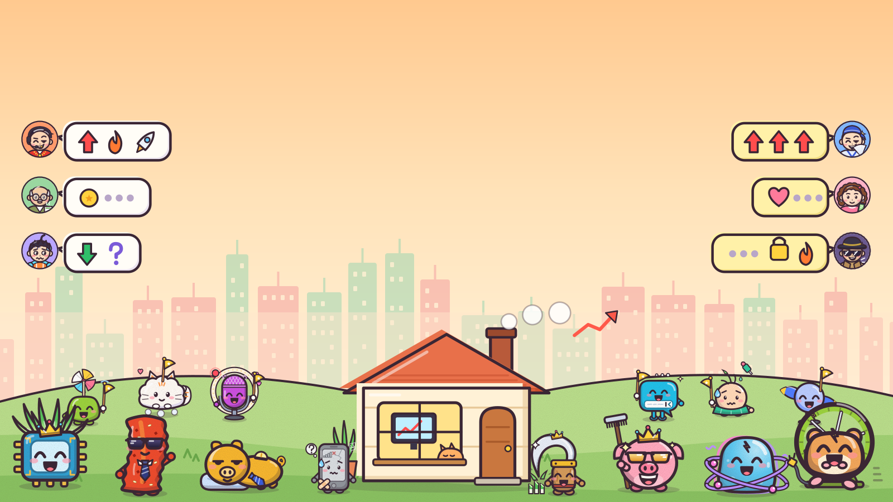

# 开盘 · Kaipan

A stock-market roguelike for the browser: you are a small-time retail trader who reads the group-chat gossip, picks cartoon "stock buddies" and tries to pay next month's bill.

**English** · [简体中文](README.zh-CN.md)



## Features

- **Real price action, fictional everything else.** Every run replays one of 135 slices of real 1996–2018 US market history (public-domain data), scaled into the game; years, companies and tickers never appear on screen.
- **Two taps a day.** Before the open, read the chat and buy or sell one stock; hit **Open** and watch hot themes rotate and leaders drag their followers up. Pay the bill at the end of every month or the run is over.
- **A cast with opinions.** 10 chat friends with their own personalities and visible track records, 5 personas, 8 difficulty levels, 57 achievements.
- **More ways to play.** Position sizing, shorting and bank loans; an IPO lottery, a "black swan" boss day and earnings weeks in real-market runs.
- **Modes.** A 5-month short run or a full year, a daily challenge, a 5-minute flash run, a weekly market with one special rule, friend challenges, and a live mode that stakes play chips from the Arcade wallet (play money only: chips can't be bought, cashed out or transferred).
- **Deterministic rules core.** `src/core/` is pure: same seed + same actions = the same run, bit for bit. Saves, replays, challenges and the bot simulator rely on it.
- **Desktop and phone.** A 1280×720 desktop layout plus landscape and portrait phone layouts; original SVG art and procedurally generated audio.
- **Runs standalone.** One Cloudflare Worker; login, cloud saves, leaderboards and chips appear only when it is mounted next to the Arcade platform.

## Quick start

Node 22 (see `.nvmrc`), in this directory:

```bash
npm ci
npm run dev       # http://localhost:5173
npm test          # Biome lint + vitest: rules, replays, content, platform layer, Worker, architecture checks
npm run build     # type check + production build to dist/
```

Simulator, smoke screenshots, audio check and art pipeline: [tools/README.md](tools/README.md). Debug URL parameters: [docs/core-api-modes.md](docs/core-api-modes.md) section 14.

Deploy on your own: `npm run deploy` (needs `CLOUDFLARE_API_TOKEN` and `CLOUDFLARE_ACCOUNT_ID`), or

[](https://deploy.workers.cloudflare.com/?url=https://github.com/gzyyyyyyu/arcade/tree/main/games/kaipan)

## Project layout

```
src/
  core/       rules core: pure, seeded, no DOM or network (numbers in balance.ts)
  view/       Phaser scenes, trading screen parts, menus, UI kit, audio
  platform/   saves, profile, cloud sync, leaderboards, live-mode ledger
  worker/     the game's Worker: login gate, wallet API, routing
  debug/      URL parameters and the window.__game bridge
public/       SVG art and baked atlases, market segments, daily/weekly rules
tests/        vitest suites
tools/        bots and simulator, smoke screenshots, art, audio and data pipelines
docs/         design and interface docs
```

## Documentation

Design docs are in Chinese. [docs/README.md](docs/README.md) maps section numbers to files.

- [docs/play.md](docs/play.md) — how to play: a day, a month, modes, home screen, controls, settings.
- [docs/design-play.md](docs/design-play.md) — design pillars, beginner glossary, copy rules, a run step by step, pacing, items and events.
- [docs/design-market.md](docs/design-market.md) — how real market data drives the game, positions and shorting, chat intel, monthly bills.
- [docs/design-persona.md](docs/design-persona.md) — personas and difficulty, achievements, endings and titles.
- [docs/design-modes.md](docs/design-modes.md) — flash run, black swan day, weekly market, IPOs, earnings week and the top-traders board.
- [docs/design-chat.md](docs/design-chat.md) — chat friends and stock buddies: moods, personalities, reactions, line rotation.
- [docs/design-lesson.md](docs/design-lesson.md) — onboarding: why new players lose, the tutorial run, easier first runs, trading tips.
- [docs/design-balance.md](docs/design-balance.md) — balancing: player models, measured results per difficulty and live tier, run length.
- [docs/design-live.md](docs/design-live.md) — live mode with play chips: buy-in and payout, leverage, wallet API, error copy.
- [docs/core-api-engine.md](docs/core-api-engine.md) — rules-core API: principles, entry points, state, actions, events, queries.
- [docs/core-api-market.md](docs/core-api-market.md) — rules-core API: real market and segment files, positions and shorting, pacing.
- [docs/core-api-modes.md](docs/core-api-modes.md) — rules-core API: run types, content ids, hidden info, tuning tables, URL parameters.
- [docs/platform-integration.md](docs/platform-integration.md) — saves and the platform: cloud sync, leaderboards, wallet, deployment, share cards, friend challenges.
- [docs/architecture.md](docs/architecture.md) — code structure, storage keys, reproducible smoke screenshots, performance rules.
- [docs/art-v3.md](docs/art-v3.md) — art and UI: direction, lighting, screens, key moments, filling wide screens, how information is shown.
- [docs/mobile.md](docs/mobile.md) — phones and tablets: when the phone layouts apply, world sizes, minimum text and tap sizes.
- [tools/README.md](tools/README.md) — every dev script and the market-data pipeline.
- [CHANGELOG.md](CHANGELOG.md) — what changed in each version; older entries in [docs/changelog/](docs/changelog/).

## Part of Arcade

Kaipan is one module of the Arcade mini-game arcade (`games/kaipan`) and can be split out and deployed on its own; see the repository root for the platform and contribution guide.

## License

MIT, see [LICENSE](LICENSE). Exception: the number font `public/assets/fonts/kaipan-num.woff2` is derived from Fredoka and licensed under SIL OFL 1.1 ([OFL.txt](public/assets/fonts/OFL.txt)).
