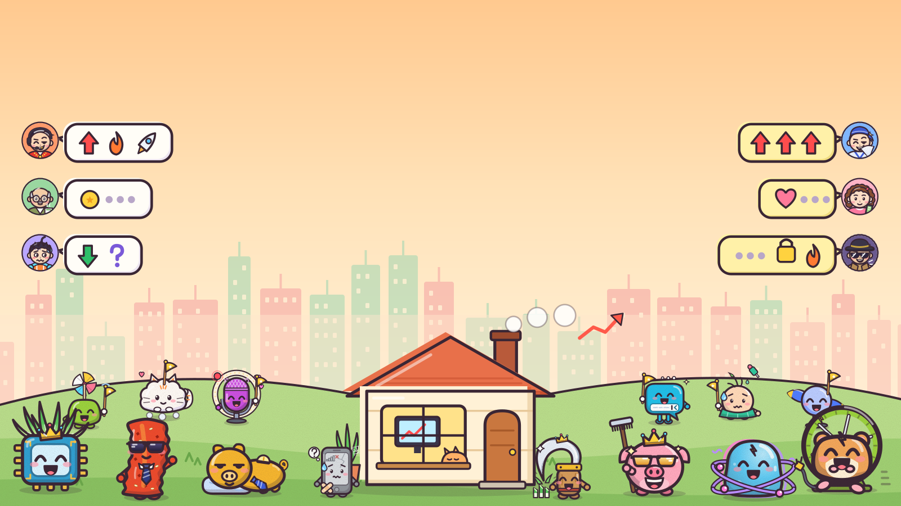

# 开盘 · Kaipan

散户炒股主题的网页肉鸽游戏：看群聊里的小道消息，挑股票小人进持仓，想办法还上下个月的账单。

[English](README.md) · **简体中文**



## 玩法

- **涨跌是真的，其余全是虚构。** 每局从 135 段 1996–2018 年美股真实走势（公有领域数据）里抽一段，按比例放进游戏；画面上不出现年份、公司和代码。
- **每天点两下。** 盘前看群聊，买一只或卖一只；点「开盘」，看风口轮动、带头大哥领着小弟涨。每月月底还账单，还不上这局就结束。
- **有脾气的一群人。** 10 位群友各有性格，战绩写在头像旁；5 个人设、8 级难度、57 个成就。
- **更多打法。** 试一口 / 半仓 / 重仓、押跌、找银行借钱；真实行情的局里还有抽新股、黑天鹅 Boss 日和财报周。
- **模式。** 5 个月短局或完整一年、每日挑战、5 分钟闪电盘、每周一条限定规则的本周市场、好友挑战，以及带大厅筹码进场的实盘（筹码只是游戏币，不能买、不能兑换、不能转让）。
- **确定性的规则核心。** `src/core/` 是纯函数：同种子同操作，整局逐位相同；存档、回放、挑战和机器人模拟都靠它。
- **电脑和手机。** 电脑 1280×720 布局，手机有横屏版和竖屏版；美术是原创 SVG，音效和音乐由代码合成。
- **能单独跑。** 一个 Cloudflare Worker；接上 Arcade 平台时才出现登录、云存档、排行榜和筹码。

## 快速开始

Node 22（见 `.nvmrc`），在本目录里：

```bash
npm ci
npm run dev       # http://localhost:5173
npm test          # Biome lint + vitest：规则、回放、内容、平台层、Worker、架构约束
npm run build     # 类型检查 + 正式构建到 dist/
```

模拟器、冒烟截图、音频检查、美术管线见 [tools/README.md](tools/README.md)；调试用 URL 参数见 [docs/core-api-modes.md](docs/core-api-modes.md) 第 14 节。

单独部署：`npm run deploy`（需要环境变量 `CLOUDFLARE_API_TOKEN`、`CLOUDFLARE_ACCOUNT_ID`），或点

[](https://deploy.workers.cloudflare.com/?url=https://github.com/gzyyyyyyu/arcade/tree/main/games/kaipan)

## 目录结构

```
src/
  core/       规则核心：纯函数、带种子，不碰 DOM 和网络（数值在 balance.ts）
  view/       Phaser 画面：场景、对局各部分、菜单、基础件、音频
  platform/   存档、档案、云同步、排行榜、实盘的本地账
  worker/     开盘自己的 Worker：登录闸门、钱包接口、分流
  debug/      URL 参数和 window.__game 调试接口
public/       SVG 素材和烘焙图集、行情段、每日和每周规则
tests/        vitest 测试
tools/        机器人与模拟器、冒烟截图、美术、音频和数据管线
docs/         设计和接口文档
```

## 文档

设计文档只有中文版。[docs/README.md](docs/README.md) 是节号和文件的对照。

- [docs/play.md](docs/play.md)：怎么玩：一天、一个月、各种玩法、主页、操作、设置。
- [docs/design-play.md](docs/design-play.md)：设计支柱、小白词表、文案规矩、一局怎么玩、节奏、道具和事件。
- [docs/design-market.md](docs/design-market.md)：真实行情怎么驱动、仓位和押跌、群聊情报、月供。
- [docs/design-persona.md](docs/design-persona.md)：人设与难度、成就、结局和称号。
- [docs/design-modes.md](docs/design-modes.md)：闪电盘、黑天鹅 Boss 日、本周市场、打新、财报周和龙虎榜。
- [docs/design-chat.md](docs/design-chat.md)：群友和股票小人：每局状态、性格、接话、台词轮换。
- [docs/design-lesson.md](docs/design-lesson.md)：新人为什么输、新手课、新号前几局的照顾、炒股心法。
- [docs/design-balance.md](docs/design-balance.md)：配平：玩家模型、各难度和实盘各档的实测、一局多久。
- [docs/design-live.md](docs/design-live.md)：实盘（筹码）：带入带回、杠杆、钱包接口、错误文案。
- [docs/core-api-engine.md](docs/core-api-engine.md)：规则层接口：总则、入口、状态、操作、事件、查询。
- [docs/core-api-market.md](docs/core-api-market.md)：规则层接口：真实行情与行情段文件、仓位押跌、节奏。
- [docs/core-api-modes.md](docs/core-api-modes.md)：规则层接口：局的种类、内容 id、隐藏信息、数值表、URL 参数。
- [docs/platform-integration.md](docs/platform-integration.md)：存档和平台：云存档、排行榜、钱包、部署、分享卡、好友挑战。
- [docs/architecture.md](docs/architecture.md)：代码结构、浏览器存储 key、冒烟截图怎么复现、性能规矩。
- [docs/art-v3.md](docs/art-v3.md)：美术与界面：方向、光、各画面、关键时刻、铺满、画面上的信息怎么放。
- [docs/mobile.md](docs/mobile.md)：手机和平板：什么时候用手机布局、世界尺寸、最小字号和点击区。
- [tools/README.md](tools/README.md)：所有开发脚本和行情数据管线。
- [CHANGELOG.md](CHANGELOG.md)：每版改了什么；更早的在 [docs/changelog/](docs/changelog/)。

## 属于 Arcade

开盘是 Arcade 小游戏厅的一个模块（`games/kaipan`），也能拆出来单独部署；平台和贡献指南见仓库根目录。

## 许可证

MIT，见 [LICENSE](LICENSE)。例外：数字字体 `public/assets/fonts/kaipan-num.woff2` 由 Fredoka 改出，按 SIL OFL 1.1 授权（[OFL.txt](public/assets/fonts/OFL.txt)）。
