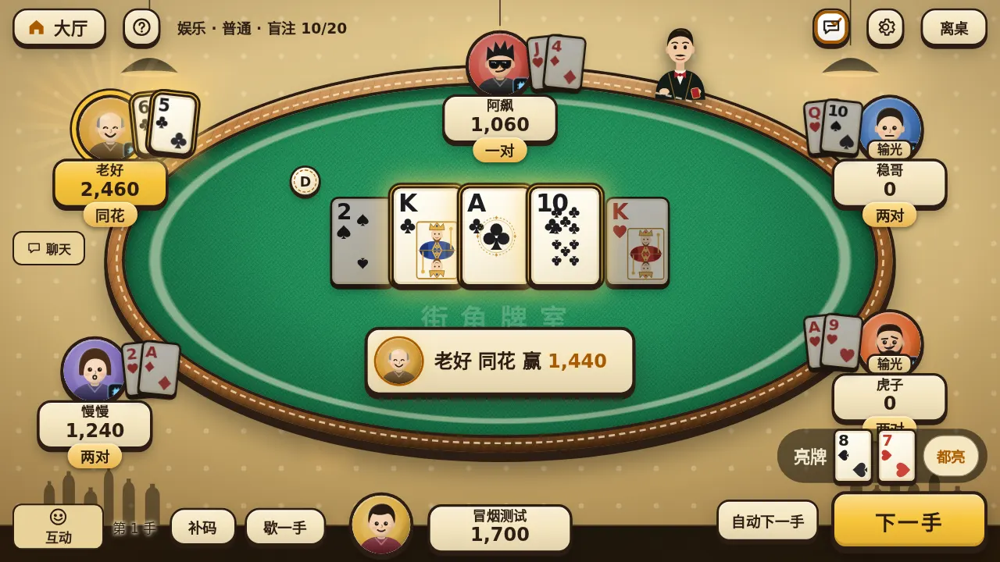

# 德州 · Texas Hold'em

No-limit Texas Hold'em for 2–9 players in the browser: solo against computer players, Sit & Go tournaments, quick match and friend rooms.

**English** · [简体中文](README.zh-CN.md)



## Features

- **Solo play** against 1–8 computer players with ten personalities. Higher tiers adjust to position, stack depth and opponents' public tendencies. Three fun difficulties (beginner / normal / expert) and four real-chip tables.
- **Sit & Go tournaments**: classic 6-player, turbo and 9-player solo; classic 6-player in friend rooms. A daily tournament gives everyone the same deck and seats.
- **Friend rooms and quick match** with a six-digit code or an invite link. Empty seats are filled by the computer, and the server never sends anyone else's hole cards.
- **Quick modes**: push-or-fold with a daily deal, and five daily poker puzzles scored by EV, both with daily leaderboards on the platform.
- **Learning aids**: a step-by-step first-hand guide, situational tips and a pot-odds bar on solo tables.
- **Table fun**: props, stickers, taunts and chat. Computer players react to them. There are 30 achievements.
- **Big moments**: all-in showdowns with live equity, slow river reveals and celebrations. The table is plain DOM + CSS, and every picture and sound is generated in code.
- **Play chips only**: real-chip tables use the platform wallet. Chips have no cash value and cannot be bought, exchanged or transferred.

## Quick start

Needs Node 22 (`.nvmrc`). Run these in this directory:

```bash
npm ci
npm run dev      # http://localhost:5175/ (fun tables work without the platform)
npm test         # type check + vitest + Worker and standalone tests in workerd
npm run build:cf # page build into dist-cf/games/texas/ (the Worker's static assets)
```

Before you send a change, also run `npm run lint`. Run `npm run smoke` (after `build:cf`) for the headless browser test. Simulators, balance scripts, smoke-test sections and how to try the Worker locally are in [docs/deploy.md](docs/deploy.md) section 10.5.

## Project layout

```
src/core/      rules core: dealing, betting, hand strength, side pots, views
src/ai/        computer players (view only): equity tables, personalities, think time
src/tour/      tournament rules
src/puzzle/    daily poker puzzles
src/room/      friend-room rules shared by the room and the page
src/app/       page flow: lobby, solo, rooms, tournaments, puzzles, guide
src/view/      DOM + CSS screens, table, effects, sound
worker/        Cloudflare Worker: health check, login gate, wallet proxy, rooms
test/          vitest by layer; test/worker/ and test/standalone/ run in workerd
scripts/       smoke tests, simulators, balance, frame capture
docs/          design documents (Chinese)
```

## Documentation

Design docs are in Chinese.

- [DESIGN.md](DESIGN.md): design summary, principles and which file holds each chapter.
- [AGENTS.md](AGENTS.md): module conventions and pitfalls, for developers and coding agents.
- [docs/rules.md](docs/rules.md): rules core and randomness.
- [docs/ai.md](docs/ai.md): computer players, personalities and balance tables.
- [docs/online.md](docs/online.md): friend rooms and quick match.
- [docs/tournament.md](docs/tournament.md): Sit & Go tournaments and the daily tournament.
- [docs/economy.md](docs/economy.md): chips, wallet and daily quotas.
- [docs/features.md](docs/features.md): guide, achievements, push-or-fold, daily puzzles and other modes.
- [docs/experience.md](docs/experience.md): pacing, limits and how they are explained to players.
- [docs/screens.md](docs/screens.md), [docs/scenes.md](docs/scenes.md): screen layout and table scenes.
- [docs/art.md](docs/art.md): art direction.
- [docs/perf.md](docs/perf.md): how performance is measured and current numbers.
- [docs/testing.md](docs/testing.md): tests, smoke sections and known trade-offs.
- [docs/deploy.md](docs/deploy.md): directory map, standalone and site deployment, security headers, every command.
- [ASSETS.md](ASSETS.md): how every asset is generated.
- [CHANGELOG.md](CHANGELOG.md): release notes. Older entries are in `docs/changelog-*.md`, indexed at the top of the changelog.

## Part of Arcade

This is one module of the Arcade mini-game site. It is mounted at `/games/texas/` and uses the platform for login and the chip wallet. It also deploys on its own: `wrangler.jsonc` is a standalone config, so `npm run deploy` (or the button below) gives you a playable game with guest identity, fun tables and friend rooms, but no wallet. See [docs/deploy.md](docs/deploy.md) section 10.1.

[](https://deploy.workers.cloudflare.com/?url=https://github.com/gzyyyyyyu/arcade/tree/main/games/texas)

Contributions go through pull requests on the Arcade repository. Commit messages start with `texas:`, and module rules are in [AGENTS.md](AGENTS.md).

## License

MIT, see [LICENSE](LICENSE).
