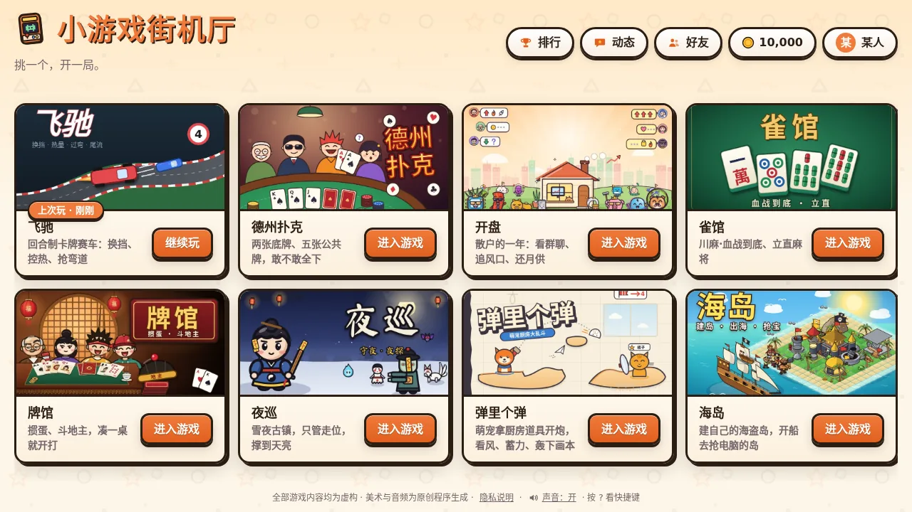

# 平台 · Arcade Platform

The lobby, accounts and `/api` of the Arcade mini-game site — one Cloudflare Worker plus a D1 database that every game talks to.

**English** · [简体中文](README.zh-CN.md)



## Features

- **Lobby**: game cards (the last game you played comes first), one notice at a time, enter/exit transitions, hotkeys and a three-step tour; anonymous visitors send no `/api` request.
- **Invite-only accounts**: username + password + recovery code; registration is closed by default and opened with invite codes (`/i/<code>`) or by an admin.
- **Friends and feed**: friend codes, requests, blocking, online status, one-click join into a friend's room, meetups, and a feed with likes.
- **Play-chip wallet**: one balance for every game. Game servers buy in, cash out and exchange through the `WalletService` RPC; browsers can only look and claim the daily relief. Chips cannot be bought, sold or transferred.
- **Stats and leaderboards**: badge wall, per-game summaries, weekly net-win board plus per-game weekly and daily boards, async challenge links, shareable result cards.
- **Cloud saves** at `/api/saves/<game>/<slot>`, whitelisted by the game registry in `shared/games.ts`.
- **Admin console** at `/admin` and a command-line tool (`npm run admin`).
- **Abuse limits and monitoring**: persistent rate limits, per-category write budgets with read-only/off tiers, health checks and a 5-minute monitor.

## Quick start

Requires Node 22 (`.nvmrc`).

```bash
npm ci
npm run build && cp .dev.vars.example .dev.vars
npm run dev:api   # API on 0.0.0.0:5181 (local D1)
npm run dev       # UI on 0.0.0.0:5180, proxies /api to 5181
npm test          # type check + vitest in workerd
npm run build     # type check + production build to dist/
```

Registration is closed locally too; create an admin first:

```bash
ARCADE_ADMIN_TOKEN=dev:local-dev-admin-token-000000 npm run admin -- create me Me --admin --base=http://localhost:5181
```

## Project layout

```
platform/
├─ src/          UI (React + Vite): features/, lib/, pages/
├─ shared/       data and pure functions used by both UI and Worker (game registry)
├─ worker/       Worker entry and /api (account, social, scores, wallet, ops)
├─ migrations/   D1 migrations, append-only
├─ public/       static assets, CSP headers, game covers
├─ test/         API tests (vitest in workerd)
├─ tools/        UI smoke test, admin CLI, cover generator
└─ docs/         module docs and archived changelogs
```

## Deployment

The platform must be deployed before the games, which call it through the `arcade` service binding. This repository's production site is deployed only by GitHub Actions from `main`; a fork can use the Deploy to Cloudflare button (platform only) or self-host. See [docs/deploy.md](docs/deploy.md).

## Documentation

Design docs are in Chinese.

- [docs/development.md](docs/development.md) — local development, browser storage keys, adding a game, and the full code map.
- [docs/deploy.md](docs/deploy.md) — bindings and secrets, one-click deploy, the production pipeline, the admin CLI.
- [docs/pages.md](docs/pages.md) — how each page is laid out and behaves.
- [docs/style.md](docs/style.md) — color tokens, motion and sound.
- [docs/smoke.md](docs/smoke.md) — UI smoke test sections and when to run each.
- [ASSETS.md](ASSETS.md) — where every image and font comes from.
- [CHANGELOG.md](CHANGELOG.md) — version history.
- The API contract lives in the Arcade repository root: `docs/platform-backend.md` and `docs/api.md`.

## Part of Arcade

This is the `platform/` module of the Arcade repository. It has its own package, tests and Worker config, so it can also be split out and deployed on its own.

## License

MIT, see [LICENSE](LICENSE). `worker/api/account/weak-passwords.ts` is taken from SecLists (MIT, Copyright (c) 2018 Daniel Miessler).
